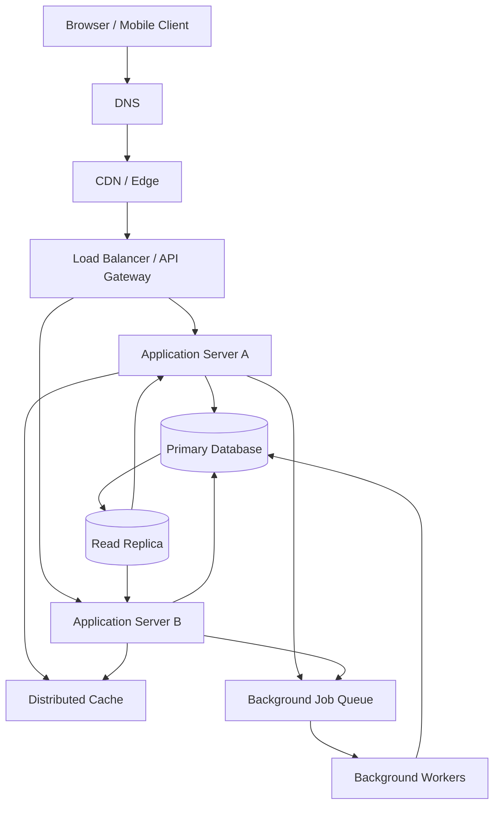

# QuickNotes System Architecture

## 1. Overview

QuickNotes is a web application that allows users to create, view, update, delete, and organize notes using tags. The browser communicates with a REST API, which authenticates users and stores their notes in a relational database.

The proposed production architecture is designed to support one million registered users while remaining secure, reliable, and responsive.

## 2. Functional Requirements

1. Users can register, sign in, and sign out securely.
2. Users can create, view, update, and delete their own notes.
3. Users can search and filter their notes.
4. Users can create tags and assign tags to notes.
5. Users can paginate through their notes.
6. Users cannot access another user's private notes.
7. The system returns useful validation and error messages.

## 3. Nonfunctional Requirements

### Performance
- Common note-list requests should aim for a response time below 300 ms at the 95th percentile under normal load.
- The API should support horizontal scaling by adding application servers.
- Frequently requested data may be cached when appropriate.

### Availability
- Target 99.9% monthly availability for the API.
- Multiple application instances should prevent one application-server failure from taking down the service.
- Database backups and tested recovery procedures should protect against data loss.

### Security
- All external traffic uses HTTPS.
- Authentication and authorization are required for private resources.
- Passwords are stored as secure hashes.
- Database queries use parameterized statements.
- Secrets are stored in a managed secret store rather than source code.

### Scalability
- Application servers should be stateless so traffic can be distributed across instances.
- The database should support indexes, connection pooling, backups, and read replicas.
- Queues should handle background tasks and temporary bursts in workload.

### Maintainability
- API endpoints and error responses follow a consistent documented format.
- Automated tests and monitoring help detect regressions and production problems.

## 4. Capacity Estimates

These are planning assumptions, not measured production traffic.

### Assumptions

- Registered users: 1,000,000
- Daily active users: 10%, or 100,000 users
- Each daily active user opens the notes feed 20 times per day
- Each daily active user creates 2 notes per day
- Average stored note content and metadata: 2 KB
- Every day has 86,400 seconds

### Estimated read traffic

Daily note-list requests:

100,000 users × 20 requests = 2,000,000 requests/day

Average read request rate:

2,000,000 ÷ 86,400 ≈ 23 requests/second

If peak traffic is five times the daily average:

23 × 5 ≈ 115 read requests/second

### Estimated write traffic

Daily note creations:

100,000 users × 2 notes = 200,000 notes/day

Average write request rate:

200,000 ÷ 86,400 ≈ 2.3 writes/second

At five times the average:

2.3 × 5 ≈ 11.6 writes/second

These estimates cover note creation only. Updates, deletes, authentication, searches, retries, and other operations would add traffic.

### Estimated storage growth

Annual note count:

200,000 × 365 = 73,000,000 notes/year

Annual raw note data:

73,000,000 × 2 KB ≈ 146 GB/year

This estimate excludes indexes, backups, replication, logs, and database overhead. Production capacity planning should include those additional costs and expected retention.

## 5. High-Level Architecture

## 6. Component Responsibilities

- **Browser / mobile client:** Provides the interface for creating, viewing, and managing notes.
- **DNS:** Resolves the application domain to the appropriate network endpoint.
- **CDN / edge:** Caches static assets near users and can help absorb traffic spikes; private note data must not be publicly cached.
- **Load balancer / API gateway:** Distributes requests across healthy application servers and can enforce rate limits.
- **Application servers:** Validate input, authenticate users, enforce permissions, and implement business logic.
- **Distributed cache:** Reduces repeated database reads for suitable, frequently accessed data.
- **Primary database:** Handles durable writes and maintains authoritative note data.
- **Read replica:** Offloads eligible read queries from the primary database, with the possibility of replication lag.
- **Background job queue:** Buffers asynchronous tasks and absorbs temporary bursts.
- **Background workers:** Process queued tasks such as notifications, exports, and other noninteractive work.

## 7. GET /notes Request Flow

1. The client sends `GET /v1/notes` with its authentication token.
2. DNS resolves the API domain, and the request reaches the load balancer.
3. The load balancer selects a healthy application-server instance.
4. The server validates the token and confirms the user's identity.
5. The server checks the cache if the query is suitable for caching.
6. On a cache miss, the server queries the read replica or primary database according to consistency requirements.
7. The server returns a paginated JSON response.
8. Suitable cache entries are updated or expired according to the caching policy.

Private notes must be scoped to the authenticated user. Cache keys must include the user identity and relevant query parameters to prevent data leakage.

## 8. POST /notes Request Flow

1. The client sends `POST /v1/notes` with a JSON body and authentication token.
2. The load balancer routes the request to a healthy application server.
3. The application server validates the token, request format, title, and user permissions.
4. The server inserts the note into the primary database using a parameterized query.
5. The database commits the transaction and returns the new note ID.
6. The server invalidates or refreshes any affected cached data.
7. The API responds with `201 Created` and the new note representation.

If a request fails, the API returns a consistent error response. Clients should not retry non-idempotent creation requests blindly unless the API supports idempotency keys.

## 9. Reliability and Single Points of Failure

- **Application servers:** Run at least two instances across separate failure domains and use health checks.
- **Load balancing:** Use a managed or redundant load-balancing service rather than one manually maintained server.
- **Database:** Use automated backups, point-in-time recovery, monitoring, and a documented failover procedure.
- **Read replica:** Monitor replication lag and avoid relying on it for reads that require immediate consistency.
- **Queue:** Use a durable, replicated queue with retry limits and dead-letter handling.
- **Cache:** Treat the cache as disposable; the database remains the source of truth.
- **DNS and CDN:** Use reliable managed services and appropriate health checks and configuration practices.

A read replica is not a complete backup or automatic disaster-recovery solution by itself. Recovery and failover must be configured and tested.

## 10. Design Trade-offs

### SQL database versus NoSQL
A relational database provides transactions, foreign keys, and strong support for user-note-tag relationships. The trade-off is that scaling writes across many database nodes can require more planning.

### Cache versus data freshness
Caching reduces database load and can improve latency. However, stale entries may show outdated notes, so writes must invalidate or refresh relevant cache entries.

### Read replicas versus consistency
Read replicas increase read capacity, but replication lag can cause a newly created or updated note to be temporarily absent from replica reads. Read-after-write operations may need to use the primary database.

### Synchronous versus asynchronous processing
Synchronous operations return immediate results but keep the request open while work is performed. Asynchronous queues handle slower tasks more resiliently, but introduce eventual processing, retries, and additional operational complexity.

### Cost versus availability
Multiple application instances, replicas, and managed services improve resilience but increase infrastructure costs. Capacity should be monitored and adjusted as real traffic becomes available.

## 11. Monitoring and Operations

Monitor:
- API latency, request volume, and error rates
- CPU and memory utilization on application servers
- Database query latency, connection usage, storage, and replication lag
- Cache hit rate and eviction rate
- Queue depth, processing time, and failed jobs
- Backup completion and recovery-test results

Alerts should be tied to service objectives and actionable failure conditions. Capacity estimates should be revisited using observed traffic rather than assumptions alone.
